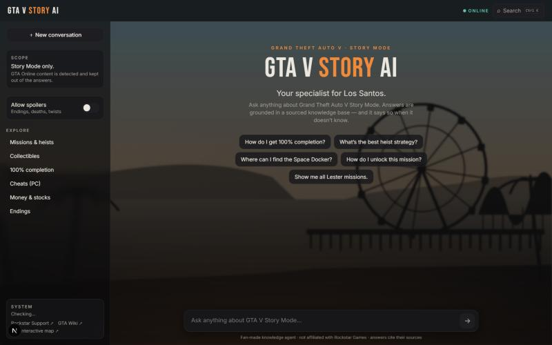
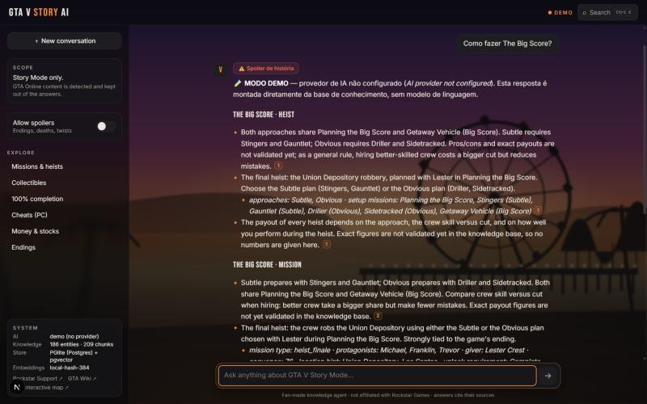
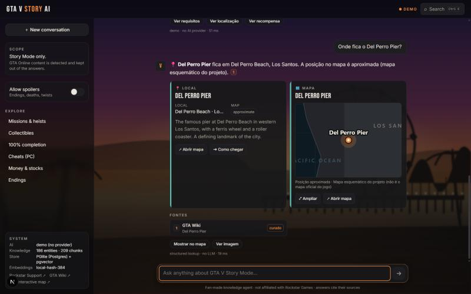
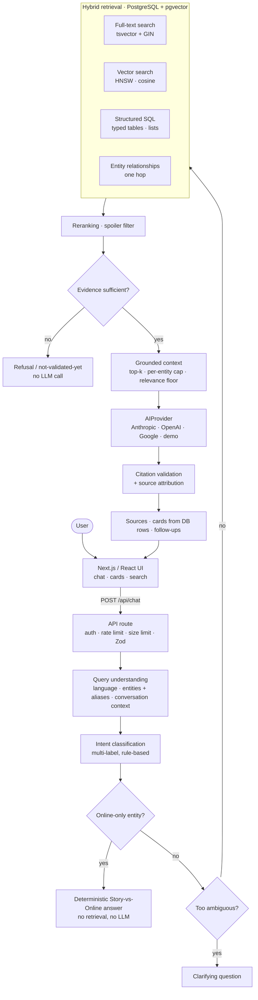

# GTA V Story Mode AI

**Live Demo:** https://gta-v-story-mode-ai.vercel.app

> **An AI agent specialised exclusively in Grand Theft Auto V Story Mode.** It answers practical gameplay questions from a curated knowledge base using hybrid retrieval (full-text + vector + structured SQL + entity relationships), source grounding and explicit, user-visible uncertainty.



> Fan-made portfolio project. Not affiliated with or endorsed by Rockstar Games or Take-Two Interactive. Game names and trademarks belong to their owners.

## Overview

Generic chatbots answer GTA V questions confidently and often wrongly: they invent mission names, mix GTA Online content (Cayo Perico, the Oppressor Mk II, Shark Cards…) into Story Mode answers, and never say where an answer came from.

This project is not a thin wrapper around an LLM. It is a **domain-specialised agent** that combines structured knowledge, retrieval, source grounding and controlled uncertainty, and is built to say *"I don't have validated evidence for that"* instead of guessing.

```
User asks a question
 → the system detects language, intent(s) and game entities (with aliases and conversation context)
 → retrieves relevant knowledge (full-text, vector, structured SQL, entity relationships)
 → combines structured and semantic evidence
 → reranks and filters the context, and checks that the evidence is sufficient
 → generates a grounded answer (or refuses / asks for clarification)
 → shows sources, knowledge status and structured cards
```

The agent can help with **missions** (objectives, conditions, unlocks, Gold Medal goals), **heists** (approaches, crews, setups), **characters**, **weapons**, **vehicles**, **locations**, **collectibles**, **properties**, **activities** (Strangers & Freaks, hobbies, random events), **cheats**, **troubleshooting**, **100% completion**, general gameplay questions, **ambiguous questions** (it asks which mission or version you mean), and **follow-up conversations** ("and what's the best approach?").

It does **not** have complete knowledge of GTA V. Every fact in the knowledge base carries a confidence/provenance status (VERIFIED, CURATED, UNVERIFIED, or listed in a BACKLOG of known gaps), and the agent tells the user which one applies.

## Key Features

- **Story Mode-only scope.** GTA Online content is detected and kept out of answers ("That belongs to GTA Online, not Story Mode.").
- **Hybrid RAG** on PostgreSQL:
  - full-text search (`tsvector` + GIN, `ts_rank_cd`);
  - vector search (pgvector HNSW, cosine);
  - structured SQL lookups (typed tables, e.g. *all missions given by Lester*);
  - one-hop entity relationships (a knowledge graph).
  - Results are fused by a weighted reranker.
- **Source provenance and confidence levels.** Each answer cites sources with clickable chips. Each source shows a `verified / curated / unverified` badge, and a warning line appears when an answer relies on unverified data.
- **Hallucination-aware fallback.** Evidence sufficiency is checked *before* the model is called; with too little evidence the agent refuses without calling the LLM. Known gaps are reported as "not validated yet". Citations the model invents are stripped.
- **Ambiguity detection.** A clarification question is asked for vague requests, and the agent asks which platform you play when the answer depends on the game version.
- **Conversation context.** Follow-ups inherit the entities of earlier turns; topic changes reset them.
- **Rich cards built from database rows, never from model output:** missions, characters, vehicles, weapons, collectibles, locations, maps, steps, warnings and spoilers.
- **Query planner** for questions that are really data lookups (nearest items, items in an area, typed listings, 100% requirements, what a mission unlocks). These are answered from SQL/graph/geo queries, deterministically and with citations. Composite questions are split into several goals.
- **Interactive map** (`/map`): pan/zoom, layers, search, a detail panel and "ask the agent" round-trips. Every marker shows its precision: *community coordinate*, *approximate* or *area only*. The base map is original (no Rockstar artwork).
- **Spoiler control.** Ending and twist content is hidden unless the user asks for it.
- **AI provider abstraction:** Anthropic, OpenAI and Google adapters. Without a key the app runs in a clearly labelled **demo mode**.
- **Evaluation harness:**
  - a 137-question regression suite;
  - a 56-question retrieval report with IR metrics;
  - a 74-question agent evaluation (real player questions, composite, adversarial, PT and EN);
  - a 54-question LLM-as-judge evaluation (requires a key).
- **Security controls:** input validation, size limits, rate limiting, safe Markdown, CSP, a secret/bundle audit and safe error handling.
- **Responsive, accessible UI** in PT/EN, with global search (`Ctrl/⌘ K`).
- **Del Perro Pier backdrop:** an original SVG illustration with a CSS-only morning → afternoon → evening → night cycle.

| Heist answer with spoiler badge | Location + map cards |
|---|---|
|  |  |

## Architecture



Plain location questions ("Where is the Del Perro Pier?") are answered directly from the database without an LLM call. This is cheaper and fully deterministic.

Since v2, a **query planner** sits between understanding and retrieval. Data lookups go to structured executors (SQL, weighted graph, distance on in-game coordinates), and only synthesis questions reach the LLM. The planner, the weighted graph, entity-first retrieval and quota-based context packing are described in [docs/KNOWLEDGE_ENGINE.md](docs/KNOWLEDGE_ENGINE.md).

## Knowledge Base

The knowledge base is validated JSON in `data/kb/`. It is generated by `npm run kb:build` from `scripts/dev/` and ingested into PostgreSQL as **entities → documents → chunks**, with embeddings, aliases and typed relationships.

Since v2, most of it is produced by an ingestion pipeline (`scripts/sources/` → `scripts/kb/`) rather than by hand. The pipeline does polite fetching (robots.txt, crawl delay, cache), extraction, entity resolution, strict coordinate pairing, and merging that records conflicts instead of overwriting them.

**1,258 entities · 2,964 chunks · 2,663 relationships · 469 map points.**

| Type | Entities | Chunks | Notes |
|---|---:|---:|---|
| Collectible items | 288 | 338 | Individual letter scraps, spaceship parts, nuclear waste barrels, submarine pieces, peyote plants, Under the Bridge… |
| Vehicles | 232 | 232 | Name, class, manufacturer. **No spawn locations or rarity** |
| Missions (incl. Strangers & Freaks) | 149 | 1,189 | Protagonist, giver, objectives, fail conditions, unlocks, Gold Medal |
| Locations | 141 | 229 | |
| Easter eggs | 118 | 118 | |
| Characters | 97 | 318 | |
| Random events | 57 | 171 | Location, availability, reward |
| Weapons | 47 | 75 | |
| Activities / hobbies | 39 | 77 | |
| Cheats | 21 | 29 | |
| Collectible categories | 12 | 22 | |
| Properties | 11 | 36 | Price, weekly income, buyer |
| 100% completion groups | 10 | 30 | Required vs total per category |
| Troubleshooting | 8 | 29 | |
| Heists | 6 | 32 | Strategy opinions labelled as opinion |
| Other (mechanics, endings, stock market, versions) | 11 | 28 | |
| Online-boundary entities | 11 | 11 | Used *only* to detect and refuse GTA Online mixing |

Map points by precision:
- 183 *community* coordinates, measured by players (esx_collectables, GPL-3.0 — a separate dataset in `datasets/esx-collectables/`);
- 75 *approximate*;
- 211 *area only*.

No coordinate is invented. An item is placed only where a source gives a position.

### Confidence model

| Status | Meaning | Agent behaviour |
|---|---|---|
| **VERIFIED** | Two or more independent sites agree, with a recorded retrieval date (validator-enforced) | States it plainly, with the source |
| **CURATED** | One source, or author knowledge consistent with a source | Attributes it ("according to Grand Theft Wiki…") |
| **UNVERIFIED** | Sources conflict or are weak | Presents it only as unconfirmed and names the divergence |
| **BACKLOG** | Known gap, deliberately not filled | Says it is not validated yet instead of inventing it |

Current distribution, in chunks: **VERIFIED 27 · CURATED 2,780 · UNVERIFIED 157**, plus **22 open BACKLOG items**.

**Not every fact has been independently verified.** Most of the base is curated from a single source. The status exists so that this is visible to the user instead of hidden behind a confident tone.

**How the data was collected (2026-10-06/07).**
- **Sources used:**
  - **Grand Theft Wiki** (CC BY-SA 3.0, attributed): the v2 bulk, with 2,524 chunks.
  - **esx_collectables** (GPL-3.0, positions only): 168 chunks.
  - **Earlier, hand-curated facts** from GamePressure, GTABase, GTA5Wiki, Destructoid and GTAIntel. These were re-expressed in original wording; no article text is stored.
  - Licences are detailed in [DATA_LICENSES.md](DATA_LICENSES.md).
- **What was kept:** only structured facts. Conflicts were recorded as UNVERIFIED instead of being resolved by guesswork.
- **Sources not used:** IGN refused automated fetches and Fandom sits behind a bot challenge. **Neither was circumvented**, so their URLs appear only as links.

`npm run kb:validate`, which also runs before ingestion and in CI, enforces:
- unique, namespaced ids;
- registered https sources;
- no Story/Online contamination;
- valid relation targets;
- coordinates within map bounds;
- status rules.

## RAG Pipeline

1. **Understand.**
   - Detect the language (PT/EN).
   - Extract entities with aliases, longest match first ("Mike", "joalheria", "Big Score").
   - Inherit entities from earlier turns for follow-ups.
   - Classify intents (25 intents, multi-label, rule-based: no extra LLM call).
2. **Guard.** Questions about Online-only content return the Story Mode notice immediately. A question that mixes Story and Online content gets only its Story part answered, plus the notice.
3. **Clarify.** Vague questions ("how do I do this mission?" with no context) get a clarifying question.
4. **Retrieve** from one Postgres database:
   - *Keyword:* sanitised `to_tsquery` ranked with `ts_rank_cd`.
   - *Vector:* the query is embedded once (cached) and ranked by `embedding <=> $1::vector` on an HNSW index.
   - *Structured:* the chunks of matched entities, plus exhaustive SQL for list questions (e.g. *all Lester missions*).
   - *Graph:* one-hop neighbours through `relationships` (heist → location, mission → protagonists…).
5. **Rerank.** A weighted mix of semantic, keyword, entity-match, source-authority, content-type and Story-relevance scores, scaled by chunk confidence. Sections matching the intent get a bonus (e.g. `strategy` for heist questions). Spoiler chunks are filtered out unless requested.
6. **Evidence gate.** An explicit entity match, or topical term hits with minimum similarity, is required. Otherwise the agent refuses with **no model call**.
7. **Assemble context.**
   - Top-k with a per-entity cap and a relevance floor.
   - Question terms missing from the context, and matching BACKLOG gaps, are passed to the model as explicit hints.
8. **Generate.** One call to the configured `AIProvider`. The system prompt forbids invention, requires `[S#]` citations, treats user text and retrieved text as data, and asks for the platform when the answer depends on the game version.
9. **Attribute.**
   - Citation markers are validated against the supplied context. Unknown ones are removed.
   - Citations are merged by source URL and renumbered.
   - When two chunks from the same source disagree, the weaker knowledge status is kept.
   - If the model cites nothing, the sources are shown as *consulted, not cited*.

**Conflicting sources** are never silently resolved. The divergence is stored (Source A / Source B / difference), the chunk is UNVERIFIED, and the agent names the disagreement.

**Embedding safety.** The ingest records the embedding provider, model and dimension in `kb_meta`. If the runtime embedder differs, the vector leg is disabled and logged, and keyword plus structured retrieval keep working. Incompatible vectors are never compared.

## Safety and Reliability

| Concern | How it is handled |
|---|---|
| Story Mode / GTA Online isolation | Enforced at four layers: a DB `CHECK` constraint (`story_xor_online`), the ingestion validator, an SQL filter (`online_only = false`) and a deterministic pre-retrieval guard |
| Hallucination | Evidence gate before generation, BACKLOG of known gaps, "not validated yet" data stored as such, prompt rules, citation validation |
| Insufficient evidence | Fixed refusal message ("I couldn't find enough evidence in the knowledge base…") with no LLM call |
| Source attribution | Clickable citation chips; sources limited to an https allow-list of known sites |
| Confidence metadata | Per-chunk knowledge status shown on every source and passed to the model |
| Prompt injection | User messages, conversation history and retrieved chunks are wrapped in delimiters and declared as data in the system prompt; injection attempts are covered by tests |
| Markdown rendering | Raw HTML disabled, unsafe URL protocols dropped, remote images never loaded, external links allow-listed |
| Secrets | Environment-only, server-side; nothing secret is `NEXT_PUBLIC_` |
| Provider errors | Mapped to safe error codes; provider bodies and stack traces never reach the client; logs redact key-like strings |

Prompt-injection protection is **mitigation, not a guarantee**. See [SECURITY.md](SECURITY.md) for the threat model and known limitations.

## Evaluation

| Evaluation | Command | Size | Needs a key? | Result |
|---|---|---:|---|---|
| Unit / integration / component tests | `npm test` | 307 tests, 16 files | no | **307/307 passing** |
| Full answer-pipeline regression suite | `npm run evaluate` | 137 questions | no | **137/137** |
| Retrieval evaluation (no LLM) | `npm run evaluate:retrieval` | 56 questions | no | see below |
| Agent evaluation (deterministic pipeline, no LLM) | `npm run evaluate:agent` | 74 questions | no | **74/74**, 0% hallucination, 0% Online contamination |
| Live LLM evaluation (LLM-as-judge) | `npm run evaluate:llm` | 54 questions | **yes** | **not run** |

Tests run on PGlite: real PostgreSQL with pgvector compiled to WASM, so the SQL is exercised, not mocked.

Retrieval evaluation (v1 = 323 entities; v2 = 1,258 entities):

| Metric | v1 | v2 before retrieval fixes | v2 final |
|---|---:|---:|---:|
| Intent accuracy | 100% | — | 100% |
| Entity recall | 100% | — | 100% |
| Entity precision | 90.5% | — | 91.4% |
| hit@k | 100% | — | 100% |
| Recall | 93.2% | 83.6% | **93.2%** |
| MRR | 0.904 | 0.940 | 0.923 |
| Groundedness | 100% | 98.2% | 100% |
| Precision@k | 50.8% | 57.3% | 57.1–57.7% |
| Source relevance | 57.1% | — | 65.1% |

- Recall dropped when the KB quadrupled and was recovered by retrieval changes, not by editing the gold set.
- Precision@k varies by about ±0.6 pp between seeds because of score ties.

**How to read these numbers:**
- **Precision@k and source relevance are the weakest metrics.** The context deliberately includes related entities (graph neighbours), and in demo mode every context block is listed as a source.
- **The datasets are internal.** Every regression and evaluation set was written by the author of this project, and the pipeline was tuned against the regression suite. **These results show the system behaves as designed on its own test set. They do not prove real-world factual accuracy about GTA V.**
- **LLM live evaluation: not run** because no API key was available in the development environment.
  - The harness is unit-tested with model doubles.
  - Without a key, the command records `{"status":"not_run"}` instead of a score.
  - The Anthropic, OpenAI and Google adapters have likewise **not been exercised against live endpoints**.

## Security

A security review was carried out before public release, treating every file and endpoint as attacker-visible:

- **Secret audit.** `npm run audit:secrets` scans the sources and the built client bundle for key patterns and server-only environment variable names. A repository-wide scan found no credentials, and the repository has no prior history.
- **Environment separation.** `.env*` files are git-ignored; only a placeholder `.env.example` is committed. Keys are read only in server code (`src/lib/env.ts`).
- **Provider key protection.** Provider calls happen server-side only. `/api/health` reports provider and model names, never keys.
- **Input handling:**
  - Zod validation (unknown fields stripped; message ≤ 600 characters; history ≤ 8 turns, user/assistant roles only);
  - a 16 KB body cap checked on the stream;
  - cross-site browser requests rejected;
  - optional `API_ACCESS_KEY`, compared timing-safely;
  - per-client rate limiting.
- **XSS-safe rendering:** safe Markdown, an https allow-list for links, escaped SVG labels, a strict CSP, `X-Frame-Options: DENY`, `nosniff` and HSTS.
- **SQL safety:** 100% parameterised queries; full-text terms sanitised.
- **No SSRF surface.** The server never fetches user-supplied URLs; outbound calls go only to fixed provider endpoints.
- **No command execution.** The app has no `child_process` usage, and the only filesystem reads are fixed project paths.
- **Dependency audit:**
  - `npm audit --omit=dev` reports **0 vulnerabilities** in production dependencies.
  - The full `npm audit` reports **5 high-severity advisories in development tooling only**: `braces`, reached through `eslint-config-next` → `fast-glob` → `micromatch`. They do not ship to users. The only automated fix is a breaking downgrade of `eslint-config-next`, so they are documented rather than force-fixed.

To report a vulnerability, see [SECURITY.md](SECURITY.md).

## Tech Stack

- **Next.js 16** (App Router), **React 19**, **TypeScript** (strict)
- **Tailwind CSS 4**
- **PostgreSQL + pgvector**: **PGlite** (embedded, WASM) by default, or any Postgres/Supabase via `pg`
- **Zod** for validation, **react-markdown** + **remark-gfm** for rendering
- **AI provider abstraction** over the Anthropic, OpenAI and Google REST APIs (plain `fetch`, no SDKs)
- Embeddings: a local hashed n-gram embedder (default, 384-dim) or OpenAI / Google (384-dim)
- **Vitest** + Testing Library (jsdom), **ESLint 9**, **tsx** scripts, GitHub Actions CI

## Project Structure

```
src/app/            Next.js pages (chat, /map), layout and API routes (/api/chat, /api/search, /api/map, /api/health)
src/components/     Chat UI, cards and the Del Perro Pier background
src/lib/rag/        Query understanding, intents, retrieval, reranking, prompt, citations, pipeline
src/lib/kb/         Knowledge schema (Zod), validation rules, ingestion, bootstrap
src/lib/ai/         AI provider and embedding adapters
src/lib/db/         PGlite / Postgres client and migration runner
src/lib/security/   Request guards, rate limiting, URL allow-list
src/lib/eval/       Regression, retrieval and LLM evaluation harnesses
db/migrations/      Versioned SQL schema (tables, constraints, indexes, RLS)
data/kb/            The project's own knowledge base (JSON), sources and backlog; data/gazetteer.json: area reference points
datasets/           Third-party datasets, one directory per licence (CC BY-SA 3.0 / GPL-3.0), read at seed time — see datasets/README.md
scripts/            CLI: migrate, seed, validate, evaluate, ask, explain, audit; scripts/dev builds the KB
eval/               Evaluation question sets
tests/              Unit, integration and component tests
```

## Getting Started

**Prerequisites:** Node.js 20.9+ (developed on Node 24) and npm. Docker is not needed.

```bash
git clone https://github.com/eduardomartim/gta-v-story-mode-ai.git
cd gta-v-story-mode-ai
npm install
cp .env.example .env.local     # optional: everything runs without keys (demo mode)
npm run db:seed                # migrate + validate + ingest into ./.data/pglite
npm run dev                    # http://localhost:3000
```

Quality checks:

```bash
npm run db:validate            # knowledge-base data-quality rules
npm run lint && npm run typecheck && npm test && npm run build   # or: npm run check
npm run evaluate               # 137-question regression suite
npm run evaluate:retrieval     # retrieval metrics
npm run evaluate:llm           # live LLM evaluation (needs a provider key)
npm run audit:secrets          # secret / client-bundle audit (after a build)
```

Other useful scripts:
- `npm run ask -- "How do I do The Big Score?" "and the best approach?"`: multi-turn questions from the terminal.
- `npm run explain -- "question"`: shows the ranked retrieval candidates behind an answer.
- `npm run kb:coverage`: coverage by category and status.
- `npm run kb:build`: regenerates `data/kb/` from `scripts/dev/`.

**PGlite is single-process.** Stop `npm run dev` before running `db:seed`, or other scripts that open `./.data/pglite`, or use `DATABASE_URL` with a real Postgres. An empty PGlite database is auto-seeded on the first request.

## Environment Variables

All variables are documented in [`.env.example`](.env.example). Placeholders only; never commit real values.

**Required: none.** With no configuration the app runs on embedded PGlite in demo mode.

| Variable | Kind | Purpose |
|---|---|---|
| `AI_PROVIDER` | optional | `anthropic` · `openai` · `google` · `none`. When unset, the provider is auto-detected from whichever key exists |
| `ANTHROPIC_API_KEY` | provider-specific | Needed for Anthropic |
| `OPENAI_API_KEY` | provider-specific | Needed for OpenAI chat, or for `EMBEDDING_PROVIDER=openai` |
| `GOOGLE_API_KEY` | provider-specific | Needed for Google chat, or for `EMBEDDING_PROVIDER=google` |
| `AI_MODEL` | optional | Model override. Defaults: `claude-haiku-4-5-20251001`, `gpt-4o-mini`, `gemini-2.5-flash` |
| `EMBEDDING_PROVIDER` | optional | `local` (default) · `openai` · `google`. Re-run `npm run db:seed` after changing it |
| `DATABASE_URL` | optional | Postgres/Supabase connection string; empty means embedded PGlite |
| `DATABASE_SSL` | optional | `require` (verify TLS) or `no-verify` (explicit insecure opt-out) |
| `API_ACCESS_KEY` | optional | Requires `x-api-key` for non-browser API callers |
| `RATE_LIMIT_PER_MINUTE` | optional | Default 20 |
| `DEBUG_MODE` | optional | `true` adds retrieval details (ignored in production) |
| `NEXT_PUBLIC_SITE_URL` | optional, public | OpenGraph base URL; not a secret |

`NEXT_PUBLIC_SUPABASE_URL` and `SUPABASE_SERVICE_ROLE_KEY` appear in `.env.example` only as a warning. The app does not use them, and a service-role key must never be exposed to the browser.

## Limitations

- **Coverage is not exhaustive.** The known gaps are listed in `data/kb/backlog.json`. They include:
  - **No vehicle spawn locations or rarity.** The agent says it has no evidence instead of listing vehicles.
  - **No item lists for Stunt Jumps, Knife Flights or Monkey Mosaics.** Only category-level facts exist.
  - Console cheat button sequences, and full vehicle and weapon statistics.
- **Collectible positions are partial.** Only 22 of the 50 letter scraps have a coordinate unambiguously paired with their description; the others are position-only points or area-level entries. Peyote plants and Under the Bridge have area-level locations only.
- **Most knowledge is CURATED** (one source), not independently VERIFIED:
  - 157 chunks are UNVERIFIED because their sources conflict;
  - 22 BACKLOG gaps remain open;
  - some numbers come from a single source and are attributed as such, e.g. Grand Theft Wiki's "weekly income $132,000" for Cinema Doppler.
- **Mission walkthroughs are outlines** (objective → location → condition), not full step-by-step guides. Some mission unlock chains are UNVERIFIED because the sources contradict each other.
- **Map coordinates are community measurements**, not official data. They are shown on an original schematic base map whose coastline is derived from the data, so the map is not a faithful in-game map.
- **Relationships are as described by sources.** The KB has no "girlfriend" mechanic: booty calls, strippers and random encounters are reported as what they are.
- **The live LLM evaluation has not been executed**, and the real provider adapters have not been run against live APIs, because no API credentials were available.
- **The default local embedder is lexical.** Cross-lingual semantic recall needs a real embedding provider.
- **PGlite has process limits.** Only one process at a time may open `./.data/pglite`, and it is meant for local and demo use. Production deployments should use `DATABASE_URL`.
- **The rate limiter is in-memory and per-instance.** It keys on `x-forwarded-for`, so it must run behind a proxy that sets that header (for example Vercel).
- **Demo mode is easy to miss.** If `AI_PROVIDER` is set but its key is missing, the app falls back to demo mode, which is labelled in the UI but not reported as an error.

## Security Disclosure

Please report vulnerabilities privately. See [SECURITY.md](SECURITY.md).

## License

**Code and the project's own knowledge base: no license has been assigned yet.** The source is publicly visible for portfolio review, but all rights are reserved by the author until a license is added.

**Third-party data keeps its own licence**, in separate directories:
- [`datasets/grandtheftwiki/`](datasets/grandtheftwiki/LICENSE.md): **CC BY-SA 3.0**, Grand Theft Wiki contributors.
- [`datasets/esx-collectables/`](datasets/esx-collectables/NOTICE.md): **GPL-3.0**, Mobius1/esx_collectables. This covers the community coordinates and the coastline traced from them.

The application reads these datasets as input files. They are not compiled into the client bundle, and the app also runs without them. See [DATA_LICENSES.md](DATA_LICENSES.md) for the details and the reasoning.
