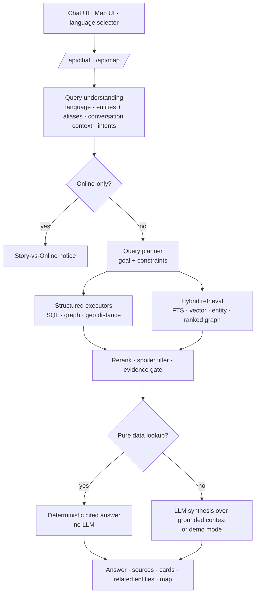
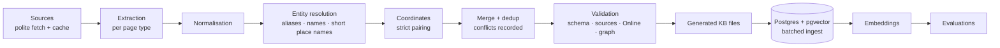

# Knowledge engine v2 — architecture, ingestion and sources

This document describes the second-generation knowledge engine: how questions are planned and answered, how the
knowledge base is built from public sources, and what was (and was not) possible legally and technically.

## 1. Audit of v1 (what was kept, what changed)

| Area | v1 | v2 decision |
|---|---|---|
| Storage | PostgreSQL + pgvector (PGlite locally), typed tables, light graph | **Kept.** Migration `0004` adds `geo_points`, `collectible_items`, `completion_requirements`, `evidence`, qualified graph edges (`props`, `knowledge_status`), 13 new predicates and the `collectible_item` type. |
| Hybrid retrieval (FTS + vector + entity + 1-hop graph) | Solid | **Kept**, but graph expansion now ranks edges by how informative they are and ignores hub edges (`available_to`, `instance_of`…), which otherwise crowd the context once the graph is dense. |
| Retrieval-only answering | Lists/locations needed similarity search to "find" rows | **New query planner + structured executors** (SQL / graph / geo). Data lookups are answered deterministically without the LLM. |
| Knowledge base | ~320 hand-curated entities, category-level collectibles | **Systematic ingestion pipeline** (source → extraction → normalisation → entity resolution → validation → dedup → confidence → DB → embeddings → eval). Item-level collectibles with positions, Strangers and Freaks, random events, characters and relationships, easter eggs, the 100% checklist. |
| Ingestion | Row-by-row inserts | **Batched multi-row inserts** (≈ 830 entities / 2 000 chunks in ≈ 5–6 s on PGlite). |
| Map | Static schematic card | **Interactive map** (`/map`): pan/zoom (wheel, drag, pinch, keys), 22 layers, search, detail panel, deep links, precision shown per marker. Coastline derived from data. |
| Language | Answer follows the question | **UI language selector** (Auto / Português / English) for the whole interface and the answers; detection stays as the fallback in Auto. |
| Bottlenecks found | — | Context crowding by hundreds of item chunks (capped unless the question is about items); hub edges in graph expansion; duplicate places under short names (resolved to the existing place). |

## 2. Request flow

### Planner goals

| Goal | Example | Executor |
|---|---|---|
| `nearest` | "5 peças de nave mais próximas de Sandy Shores" | Distance on in-game coordinates; falls back to area centres (labelled) for categories without coordinates |
| `nearby_collectibles` | "Quais colecionáveis estão perto de Sandy Shores e quais contam para 100%?" | Radius search over all categories + each category's 100% rule |
| `in_area` | "Letter scraps em Paleto Bay" | Items by area (string + `located_in` edge) |
| `list_items` / `item_lookup` | "Todas as peças de nave" / "peça de nave 37" | Item table |
| `romance` | "Namorada pro Trevor" | `hookup_with` edges with the source sentence as evidence |
| `completion` | "O que conta para 100%?" (optionally per protagonist) | `completion_requirements` (required vs total) + `available_to` edges |
| `after_mission` / `unlocked_by` | "O que vem depois de X?" / "Como desbloqueio X?" | `unlocks` / `requires` edges |
| `character_location` | "Onde encontro a Ursula?" | `lives_at`, `appears_in`, mission/event start places |
| `list_type` | "Quais propriedades geram renda?", "Quais armas posso conseguir sem comprar?" | Typed listing with a filter (income, free, has a location…). Count questions and questions naming one entity are **not** turned into listings |
| `practical_plan` (secondary only) | "…o que devo priorizar?" | Ordered next steps from the primary goal's results |

**Data lookups** (`nearest`, `in_area`, `list_items`, `item_lookup`, `nearby_collectibles`, `list_type`) are always
answered deterministically. **Synthesis goals** (`romance`, `completion`, `after_mission`, `unlocked_by`,
`character_location`) go to the LLM when a provider is configured, and otherwise produce a structured, cited answer.
**Composite questions** get secondary goals (e.g. completion + after_mission + practical_plan); their results are merged
and the `[S#]` labels renumbered. A planned goal that finds nothing returns an explicit *no-evidence* answer instead of
falling back to similarity search ("Não tenho evidência suficiente…"). This is what stops the agent from listing random
vehicles for "which vehicle can I find near Paleto Bay?" — the KB has no spawn data.

**Relationships are differentiated.** A `hookup_with` edge is created only when the character's own page describes a
"booty call", never for the protagonists themselves. The romance answer therefore says that no source describes a formal
dating system, lists the booty call(s) with their conditions, and separates strippers (Vanilla Unicorn) and paid services.

## 2b. Retrieval v2 (large-KB recall)

Growing the KB from ~320 to ~1 250 entities dropped retrieval recall from 93.2% to 83.6%: look-alike chunks and dozens of
near-identical items (30 Nuclear Waste barrels, 50 letter scraps…) pushed the right sections out of the context. The fixes:

1. **Entity-first candidates.** Every chunk of an entity the user named is a candidate, with tiered entity scores:
   explicit 1.0 › strong name match 0.9 › inherited from the conversation 0.85 › graph neighbour ≤ 0.8. A partial-name leg
   matches entities whose name contains a (translated) question word — only strong matches, so "capital da França" stays
   off-domain.
2. **Weighted graph traversal.** `PREDICATE_WEIGHT` × `INTENT_PREDICATE_BOOST`; hub edges (`available_to`, inbound
   `located_in` from items = 0.25) stay low; membership boosts (`contributes_to`) apply only from the member's side.
   Per-type caps (one collectible item, four for item questions).
3. **Query normalisation.** PT→EN glossary (fantasma→ghost, OVNI→UFO, peças de nave→spaceship parts, contratos→
   assassinations…); generic terms are excluded from the full-text query.
4. **Reranking.** Bonuses for explicit entities and intent-matching entity types; vector-only candidates ×0.75; numeric
   sections favoured for quantity questions; within an explicit entity, section relevance outweighs semantic noise.
5. **Context packing with quotas** (`assembleContext`): A) focus entities, leaving 3 slots in reserve; B) diversity —
   strongest graph neighbours first, one entity per type in the first round; C) fill by score. Throughout: per-entity cap,
   at most 2 collectible items for non-item questions, near-duplicate removal (Jaccard ≥ 0.75 on section bodies of the
   same entity), relevance floor and a character budget.

| Metric (56 held-out questions) | v1 (323 entities) | v2 before fixes | v2 final (1 258 entities) |
|---|---:|---:|---:|
| Recall | 93.2% | 83.6% | **93.2%** |
| MRR | 0.904 | 0.940 | **0.923** |
| Precision@k | 50.8% | 57.3% | **57.1–57.7%** |
| Groundedness | 100% | 98.2% | **100%** |

The gold sets were not edited to obtain these numbers. Precision@k varies by ±0.6 pp between seeds (score ties).

## 3. Ingestion pipeline

Commands: `npm run sources:fetch -- --list urls.txt` → `npm run sources:extract` → `npm run kb:import` → `npm run db:seed` →
`npm run evaluate:agent` (plus the older suites). New sources are added by writing an extractor that emits drafts — no
hand-editing of the KB.

Rules enforced by the pipeline (`scripts/kb/pipeline.ts`, tested in `tests/unit/ingestion-pipeline.test.ts`):

- records without a source, with a non-https source, or describing GTA Online content are **rejected**;
- names are resolved to existing entities (aliases, "the"-less forms, short place names like "Darnell Bros.");
- duplicates (same id, same item slot, same name and type) are **merged**; scalar disagreements become an
  **UNVERIFIED conflict section** (Source A / Source B / Difference / Confidence) instead of overwriting;
- knowledge status is **never upgraded automatically**;
- a community coordinate is attached to a described item **only when the pairing is unambiguous** (the item is the
  only described one of its area and exactly one coordinate falls nearest to that area). An audit of the first, looser
  attempt showed wrong pairings inside shared areas (e.g. the Vinewood Sign scrap receiving the BIG Juice stand's
  position), so everything else stays a clearly labelled *position-only* point.

## 4. Sources evaluated

| Source | Content quality / structure | Licence / terms | Automated access | Used? |
|---|---|---|---|---|
| Grand Theft Wiki | Good GTA V coverage: item lists by area, mission infoboxes (protagonist, giver, objective, fail, unlocks), random-event table, 100% checklist, characters | CC BY-SA 3.0 | HTML allowed by robots.txt (10 s crawl delay); `api.php` disallowed; raw-text endpoint behind Cloudflare | **Yes** (HTML only, attributed) |
| GTA Wiki (Fandom) | Most complete | CC BY-SA 3.0 | Cloudflare challenge | **No** — not circumvented |
| Mobius1/esx_collectables | 223 community-measured coordinates, no descriptions | GPL-3.0 | GitHub raw | **Yes** (positions only, attributed) |
| DurtyFree/gta-v-data-dumps | Game data dumps (vehicles, weapons, zones) | No licence (all rights reserved); also Rockstar game data | Public | **No** |
| GTA5Wiki, GamePressure, GTABase, Destructoid, GTAIntel | Guides, checklists, payouts | Proprietary | Readable | Facts only, re-expressed (earlier phases) |
| IGN | Interactive map, guides | Proprietary | Refuses automated access | **No** (linked only) |
| Official game map artwork / tiles | — | Rockstar copyright | — | **No**. The bundled base map is the author's own schematic drawing. The coastline traced from the esx coordinates is a separate GPL-3.0 dataset, served at runtime. A licensed image can be plugged in via `NEXT_PUBLIC_MAP_BASE_IMAGE` |

## 5. What could not be built (and the alternative used)

- **A faithful in-game map**: the real map is Rockstar artwork. Alternative: original schematic base whose coastline is
  traced from data, markers at real in-game coordinates, and an optional deployer-supplied base image.
- **Coordinates for every collectible**: no openly licensed dataset covers peyote, Under the Bridge, stunt jumps, knife
  flights or monkey mosaics. Those items keep their area-level location (labelled "area only").
- **Item numbering identical to the game**: neither source gives the in-game index; numbering follows each source's
  list and says so.
- **Some pages do not exist on Grand Theft Wiki** (e.g. Knife Flights, Epsilon Tracts, Hitch Lift pages): those parts stay
  at category level or in the backlog.

## 6. Where the data lives (licence separation)

The pipeline writes its output **by licence**. See `DATA_LICENSES.md` and `src/lib/kb/datasets.ts`.
- **`datasets/grandtheftwiki/`** (CC BY-SA 3.0): extracted drafts, merged records, the 100% checklist and the import report.
- **`datasets/esx-collectables/`** (GPL-3.0): position-only items, coordinate attachments for described items, and the traced coastline.
- **`data/kb/`**, **`data/gazetteer.json`**: the project's own records and reference points.

`loadKnowledgeBase()` reads `data/kb` first, then the datasets (both optional), and puts the split records back
together. A test checks that this is lossless.

## 7. Query quality v3 (planning, resolution and grounded answers)

A functional audit of the published product found that the agent rarely hallucinated, but often answered a
different question from the one asked. This round fixes the mechanisms behind that:

| Problem | Cause | Mechanism now |
|---|---|---|
| Portuguese and community wording ("cartinhas", "OVNI", "q missão…") | Entity extraction only saw aliases; the PT→EN glossary fed retrieval alone | `canonicalizeQuery()` (`glossary.ts`) **replaces** phrases with the KB's English terms and reduces diminutives of lexicon words ("cartinhas" → "cartas"; "caminho" and "sozinho" are left alone). Entity extraction, intents and the planner read this canonical text; English passes unchanged |
| Unknown names answered with unrelated evidence | No distinction between "not in the KB" and "nothing retrieved" | `resolution.ts` handles four cases: alias match, a confident near-miss (shown as "Interpretei X como Y"), a **named** mention with no match ("não encontrei uma missão correspondente a…", with similar names when there are some), and a generic noun with several referents ("Você quis dizer A, B ou C?"). Only a span written as a name (capitalised, "chamada X", or "do X" for secrets) may produce "not found". Ordinary words never do |
| 100% questions got the whole checklist | One `completion` goal and one answer shape | `completion` has modes: **overview**, **part** (a category or label family), **count / counts** (one thing), plus `completion_fact` for plain counts. Numbers come from `collectibles` and `completion_requirements` rows, matched by target id or by the whole name as a phrase. A thing missing from the checklist reports the row of what it is tied to (Space Docker → Spaceship Parts) |
| "Under the Bridge em Los Santos" → none | The area executor compared item areas only; "Los Santos" is also a *region* | `areaScope()` (`executors.ts`) covers the named places, the places inside them (`located_in`, two levels) and, when a name is a region, every item of that region. A word naming several places ("Vinewood") becomes a place group (`places`). Secrets and random events also match by their recorded location text |
| Listings ignored constraints | The planner built type-only listings | Vehicle class (PT/EN class lexicon → roster classes; a class selects a vehicle listing only next to a vehicle noun, because "super", "militar" or "polícia" also describe cheats, missions and places), protagonist (random events and Strangers and Freaks), area scope and "ordem/order" (ordered mission list) are planner constraints that the SQL executors apply |
| Compound questions answered the first part | One plan per question | `planClauses()` splits at interrogative boundaries in the user's own punctuation. Context fragments are joined to the next clause, and each clause gets its own intents. Pronouns and elliptical clauses ("quantos contam", "e contam") keep the subject; place constraints and protagonists are handled explicitly. A clause about an entity with no plan of its own becomes `entity_profile`, which answers the attribute asked (price, income, who can, time, reward) or says the KB does not record it |
| Correct evidence refused | `assessEvidence` counted only explicitly named entities | A **strong** name match is entity evidence too: ≥ 2 question words in the name, or linked to a named entity, or of the kind asked about. One-word coincidences still are not, so "capital da França" stays refused |
| Gap warnings out of context | A gap was shown when two words overlapped | Each gap has an **aspect** (rewards, unlocks, locations, statistics…), and is shown only when the question's intents match it. Two stale gap notes (random events, collectible locations) were updated to match the KB they describe |
| Demo mode read as a dump | Chunks were grouped in rank order | Groups of the kind the question asks about lead, weak groups are dropped, repeated sentences are said once, and a missing attribute is stated first |

Measured on the existing gates (gold sets unchanged): recall 93.2% → 93.2%, MRR 0.923 → 0.923, precision@k
57.7% → 58.1%, source relevance 65.1% → 76.8%, groundedness 100% → 100%, regression 137/137, agent evaluation
74/74 (precision 25.5% → 27.0%), hallucination 0%, Online contamination 0%.

### Known limitations (left for a later round)

- **Place families on common nouns:** a word shared by several place names becomes a place group. Common nouns
  ("house", "beach", "store") also qualify, so "Which house can Michael buy?" scopes to every recorded house. Telling
  a family name ("Vinewood") from a head noun needs its own design; the place group only narrows the scope and the
  answer is still grounded.

### Unresolved data issues (documented, not changed)

These look wrong or inconsistent, but the project has no second source that would justify changing them:
- **Hidden Packages:** the category record says 12; the community dataset has 13 positions.
- **Mrs. Philips:** the mission's start location reads "Sandy Shores, Los Santos". Sandy Shores is in Blaine County, and the error came from extraction.
- **Cinema Doppler:** "$132,000/week" comes from a single source, and the property listing shows it without a single-source caveat.
- **Weapons:** some curated summaries say "price not validated" while the Grand Theft Wiki record has a cost (e.g. Heavy Sniper $9,500).
- **Comet:** stored with vehicle class "sports" in lowercase. The class filter is case-insensitive, so this is cosmetic only.
- **Great Chaparral:** its region is Los Santos County, yet it is linked `located_in` Blaine County.
- **Missing place links:** many random events and easter eggs are not linked to their area by a relation. They are found by their location text instead, which can miss events described only by a road name.
